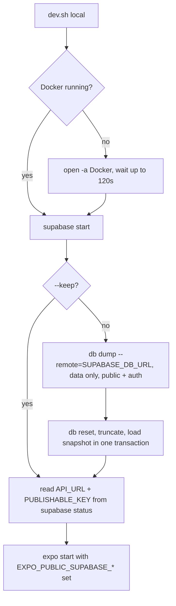

# Dev Server

One parameter picks the database: `local` or `production`.

```bash
bun run dev:local          # local Supabase, freshly copied from production
bun run dev:production     # production Supabase, nothing imported
```

Both wrap `scripts/dev.sh <local|production>`. Anything after `--` goes to `expo start`:

```bash
bun run dev:local -- --web
bun run dev:local -- --keep --web     # reuse the local data, skip the copy
bun run dev:production -- --ios
```

## Which one to use

| Target       | Database                                   | Use it when                                                                       |
| ------------ | ------------------------------------------ | --------------------------------------------------------------------------------- |
| `local`      | Docker stack at `http://127.0.0.1:54321`   | testing a migration, writing user data, or anything you would not do to real rows |
| `production` | `https://obtgldkascmxbtpnvscn.supabase.co` | checking real behaviour against live data, read-only UI work                      |

Default to `local` when the change writes data or touches `supabase/migrations/`. Writes from `production` hit real users' rows.

## What `local` does



1. Dumps production's data (`public` and `auth` schemas) to `supabase/.snapshots/production-data.sql` (gitignored).
2. `supabase db reset --local` rebuilds the schema from `supabase/migrations/`, so local always has the committed schema.
3. Truncates every `public` and `auth` table (the migrations seed catalog rows) and loads the snapshot in a single transaction. A failed load leaves the clean reset, never a half import.
4. Starts Expo with `EXPO_PUBLIC_SUPABASE_URL` and `EXPO_PUBLIC_SUPABASE_PUBLISHABLE_KEY` pointing at the local stack.

Because `auth.users` is copied, production logins work locally with the same password. Local mail goes to Mailpit at `http://127.0.0.1:54324`; Studio is at `http://127.0.0.1:54323`.

## One-time setup for the copy

The dump needs production's Postgres connection string. It is a secret, so it lives in `scripts/.env.local` (matched by `.env*.local` in `.gitignore`), never in `app/` or `src/`:

```bash
# scripts/.env.local
SUPABASE_DB_URL="postgresql://postgres.obtgldkascmxbtpnvscn:<password>@aws-0-<region>.pooler.supabase.com:5432/postgres"
```

Get it from the Supabase dashboard: Connect, Session pooler. An exported `SUPABASE_DB_URL` in the shell wins over the file. Use `envsync` to carry `scripts/.env.local` to another Mac.

Docker Desktop and `psql` (`brew install libpq` or Postgres.app) must be installed. The Supabase CLI runs through `bunx supabase`, so it needs no install.

## How the switch works

`src/api/supabaseConfig.ts` calls `resolveSupabaseTarget`, which uses the `EXPO_PUBLIC_*` override only when **both** values are set and falls back to production otherwise. A half-set environment can never pair a local URL with the production key.

`production` runs Expo with both variables explicitly unset, so a stray export in your shell cannot redirect it.

> [!WARNING]
> Metro caches modules with `EXPO_PUBLIC_*` values already inlined. `dev.sh` passes `--clear` whenever the target differs from the last run (`supabase/.temp/dev-target`), and `build:web` always clears, so a production export never ships the local URL. Never set these variables in a `.env` file: Expo loads `.env` for `build:web` too.

## Troubleshooting

| Symptom                                   | Fix                                                                                               |
| ----------------------------------------- | ------------------------------------------------------------------------------------------------- |
| `SUPABASE_DB_URL is not set`              | Add it to `scripts/.env.local`, or rerun with `--keep`                                            |
| `Docker did not start within 120s`        | Open Docker Desktop by hand, then rerun                                                           |
| Port `54321`/`54322` already allocated    | Another Supabase project is running: `bunx supabase stop --project-id <other>`                    |
| Load fails with a missing column          | Production has schema the repo's migrations lack. Pull it into a migration (`supabase-migration`) |
| App still shows the other database's data | Rerun with `-- --clear`; also clear the TanStack Query cache by signing out or clearing site data |
| Done for the day                          | `bunx supabase stop` (keeps data) or `bunx supabase stop --no-backup` (drops it)                  |

## Don't

| Don't                                                 | Why                                                                  |
| ----------------------------------------------------- | -------------------------------------------------------------------- |
| Commit `supabase/.snapshots/` or `scripts/.env.local` | They hold real user data and a database password                     |
| Run migrations against production from `dev.sh`       | It only reads production. Migrations go through `supabase-migration` |
